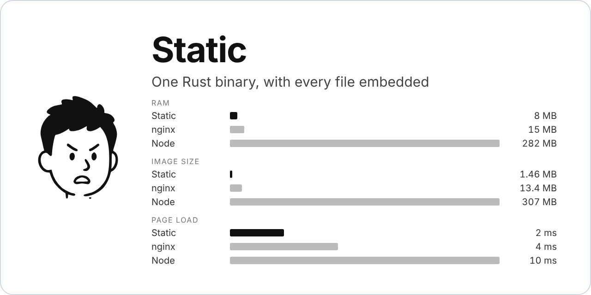

<h1 align="center">Static</h1>

<p align="center">A very fast, standalone static file web server in Rust: every file is minified, compressed and embedded in one binary.</p>

<p align="center">
  <a href="#quick-start"><b>Quick start</b></a> &nbsp;·&nbsp;
  <a href="#documents">Documents</a> &nbsp;·&nbsp;
  <a href="#how-it-works">How it works</a> &nbsp;·&nbsp;
  <a href="docs/configuration.md">Configuration</a>
</p>

<p align="center">
  
</p>

Static serves a folder of HTML, CSS, JavaScript and other files, built on
[Hyper](https://hyper.rs/) and [rustls](https://github.com/rustls/rustls). The
files are minified, compressed and embedded when the server is built, and so
is every setting, so at run time it reads no files and no environment
variables. HTTP/1.1, HTTP/2 and TLS share one port, with HTTP/3 over
[quinn](https://github.com/quinn-rs/quinn) as an option. Files get
content-hashed names, Subresource Integrity hashes and strict security
headers, and open pages reload themselves when a new build is deployed. In
Docker the whole image is under 1.5 MB.

## Quick start

Put your site in `public/`, with an `index.html`.

```sh
cd rust-server && cargo run                    # http://localhost:3000 and https://localhost:3000
PORT=8080 WORKERS=4 cargo run                  # settings are fixed at build time
DISABLE_LOGGING=false cargo run -- --summary   # logging is off by default; --summary logs req/s
cargo test
```

Or `./go.sh` to build and run it (`--docker` for the Docker image). With
`react-app/` present, `go.sh` builds that into `public/` first.

## Documents

| Document | What's in it |
| -------- | ------------ |
| [How it works](docs/how-it-works.md) | Every feature, what the build does to each file, the request path, protocol detection and auto-reload |
| [Configuration](docs/configuration.md) | Every build-time setting, with its default |
| [Building and running](docs/running.md) | Local and Docker builds, `go.sh`, the tests, logging, the project layout, and the comparison with nginx and Node |

## How it works

At build time, `build.rs` walks `public/`, minifies each file, gives it a
content-hashed name and an integrity hash, compresses it with gzip, Brotli and
zstd, and writes Rust source with every file as a byte constant, a prebuilt
set of headers for it, and one `match` from URL path to file. At run time a
request is a lookup in that `match`, a copy of the prebuilt headers, and the
embedded bytes in the best encoding the client accepts. Each worker thread has
its own listener on the same port (`SO_REUSEPORT`), and the first byte of each
connection decides between TLS and plain HTTP.
[How it works](docs/how-it-works.md) has the details.

## License

MIT

---

<p align="center"><sub>Part of <a href="https://daleobrien.github.io/#servers">Servers &amp; Systems</a> &nbsp;·&nbsp; more at <a href="https://daleobrien.github.io">daleobrien.github.io</a></sub></p>
